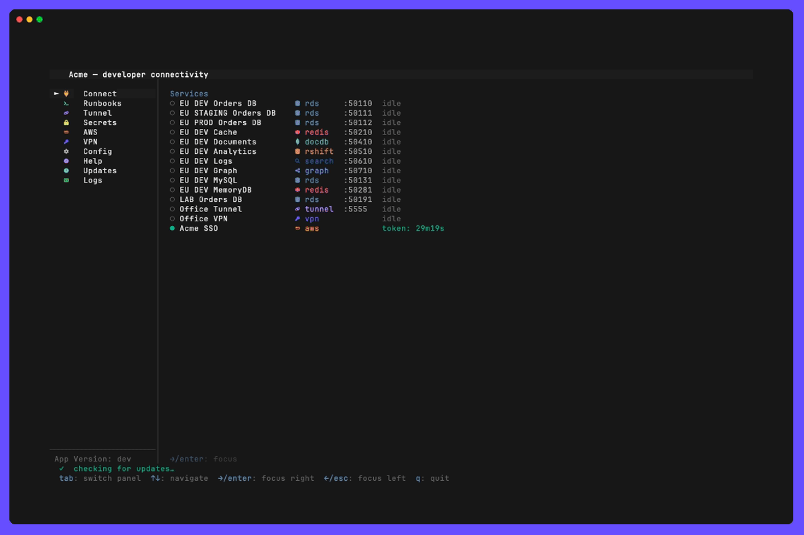

> den -  **D**eveloper **E**nvironment **N**avigator — reach RDS, Redis, DocumentDB, Redshift, OpenSearch, Neptune and Docker environments via AWS SSM tunnels from a single TUI (Kafka is planned).

<p align="center">  </p>

Private databases and caches in AWS sit behind a bastion, and reaching one by hand means an `aws ssm start-session` command, a token command and a `~/.pgpass` edit, redone every 15 minutes. den does all three from one dashboard: it opens the tunnel, mints and refreshes the IAM credential, and reconnects when the tunnel drops.

<p align="center"></p>

New to den? The [Quickstart](docs/quickstart/README.md) goes from a fresh machine to a `psql` prompt on a private database.

## Features

- **Split-pane TUI** — left menu navigates between 11 panels: ⚡ Connect · 🔌 Tunnel · 📋 Runbooks · ☁ AWS · 🔒 VPN · 🔐 Secrets · 🐳 Create Env · ⚙ Config · ? Help · ↑ Updates · 📄 Logs
- **One tunnel model for every service** — a shared port-forward core opens the tunnel, mints the credential, refreshes it and reconnects when it drops
- **[Transports](docs/transports/README.md)** — reach the network through SSM (default), an SSH bastion, an EC2 Instance Connect Endpoint or `kubectl port-forward`
- **[AWS SSO](docs/aws/README.md)** — one login entry per SSO session, curated and named from `den.yaml`
- **[Network tunnels](docs/tunnel/README.md)** — SSH/SOCKS tunnels with a real data-path health check, not just a local listener
- **[VPN](docs/vpn/README.md)** — `openfortivpn` + SAML, with an optional privilege helper so connecting never prompts for your admin password
- **[Runbooks](docs/runbooks/README.md)** — your own scripts and tools, one folder each, run with den's context (AWS profile, region, live tunnel ports as `DEN_PORT_*`); each opens like a service, with its logs, its run history and terminals in its folder
- **[Runbook sources](docs/runbook-sources/README.md)** — your team's runbooks from a git repository, listed as `<source>/<name>`: pinned in `den.lock`, updated only when you ask, install the ones you want, and a new or changed one asks before it runs
- **[Secrets](docs/secrets/README.md)** — view, search and copy secrets from SOPS files, AWS Secrets Manager, KeePassXC and HashiCorp Vault without leaving den. Values are masked until revealed and never written to disk or the log, and SOPS files can be edited in `$EDITOR`
- **[Terminal tabs](docs/terminal/README.md)** — `t` in a data store's detail view runs its client (`psql`, `mysql`, `redis-cli`, `mongosh`) inside den, next to the logs and already logged in; for OpenSearch and Neptune it is your shell with `DEN_URL` set to the signing proxy. Several tabs per service, renamable and closable. On a terminal that supports it, `Shift`+`Enter` adds a line in an agent's prompt, the cursor takes the client's shape, and den sets the window title and the tab's progress bar
- **[Shortcuts pop-up](docs/shortcuts/README.md)** — `h` or `?` in any service's detail view and any runbook's view, and in the Connect, Tunnel, VPN, AWS, Secrets, Runbooks, Config and Help panels, lists the keys that work there and what each one does
- **[Help panel](docs/help-panel/README.md)** — den's manual inside den: one [topic](docs/help/README.md) per feature, each saying what it is, what you can do, what it needs, how to configure it (with examples) and what it cannot do; `/` searches every topic
- **Clipboard** — copy ready-to-use connect commands with `y` (`Y` inlines the password, `p` copies the raw token)
- **[Config reload](docs/config-reload/README.md)** — edit `den.yaml` from the Config panel (`e`) and it applies when your editor closes, menu included; `R` reloads an edit made elsewhere. Unchanged connections stay up, den asks before stopping one, and a file with mistakes is not applied: every error is listed with its line, with edit-again and undo
- **[Config check](docs/config-check/README.md)** — `den config --check` lists every problem in `den.yaml` with its line and a hint on how to fix it: unknown keys, files that are not there, local ports two services share, AWS profiles that are not defined, names used twice. `--json` and `--strict` make it a pipeline gate; the Config panel shows the same list (`p`), marked beside the lines
- **[AI agents](docs/mcp/README.md)** — `den mcp` lets Claude Code or Cursor list services and open tunnels, never seeing a credential; production needs your confirmation

## Supported Services

| Service | Auth | Docs |
|---------|------|------|
| **RDS / Aurora** (PostgreSQL) | IAM auth token, refreshed every 13 min, written to `~/.pgpass` | [docs/rds](docs/rds/README.md) |
| **RDS / Aurora** (MySQL, MariaDB) | IAM auth token in a per-service option file (`engine: mysql`) | [docs/rds](docs/rds/README.md) |
| **ElastiCache** (Redis OSS, Valkey) | ElastiCache IAM auth token, refreshed every 13 min | [docs/elasticache](docs/elasticache/README.md) |
| **MemoryDB** | MemoryDB IAM auth token (`memorydb: true`) | [docs/memorydb](docs/memorydb/README.md) |
| **DocumentDB** | mongosh `MONGODB-AWS` — no token, no refresh | [docs/documentdb](docs/documentdb/README.md) |
| **Redshift** (provisioned + Serverless) | Temporary database credentials, 15 min–1 h, written to `~/.pgpass` | [docs/redshift](docs/redshift/README.md) |
| **OpenSearch** (domain + Serverless) | Local SigV4 signing proxy — clients talk plain HTTP to localhost | [docs/opensearch](docs/opensearch/README.md) |
| **Neptune** | Same signing proxy — openCypher, SPARQL and Gremlin unsigned | [docs/neptune](docs/neptune/README.md) |
| **Kafka** | _Planned, not implemented yet_ — Amazon MSK with IAM auth | — |
| **Docker** | Local Docker Compose stack | [docs/docker](docs/docker/README.md) |

## Supported Secret Providers

The 🔐 Secrets panel lists the secrets configured under `secrets:` in `den.yaml`,
grouped by provider. Each provider reuses the login you already have, whether its
CLI's own login or your AWS profile. `den.yaml` only refers to secrets and never
holds their values. Full details are in [docs/secrets](docs/secrets/README.md).

| Provider | `den.yaml` group | How den reads it | Edit | Needs |
|----------|------------------|------------------|------|-------|
| **[SOPS](https://github.com/getsops/sops)** (KMS, age, PGP) | `sops` | `sops --decrypt`; keys nested as in the file, or flat (`db.password`) | `e` via `sops edit` | `sops` 3.9+ |
| **AWS Secrets Manager** | `aws_secretsmanager` | AWS SDK `GetSecretValue` as `aws_profile`; JSON shown like a SOPS file | read-only | IAM `secretsmanager:GetSecretValue` |
| **[KeePassXC](https://keepassxc.org)** (`.kdbx`) | `keepassxc` | `keepassxc-cli show`; master password asked in the panel, sent on stdin, optionally remembered (`remember_password`); one `entry`, or pick from a list | read-only | KeePassXC 2.x |
| **[HashiCorp Vault](https://developer.hashicorp.com/vault)** (KV v1/v2) | `vault` | `vault kv get` with your own token; a path ending in `/` lists a folder; `L` runs your `login` command (e.g. OIDC) | read-only | `vault` CLI 1.11+ |

**Planned, not implemented yet.** Using one of these groups in `den.yaml` stops
den loading with `secrets.<group>: unsupported provider`. Their intended config
is in the commented examples in [`den.yaml`](den.yaml).

| Provider | `den.yaml` group | Planned approach |
|----------|------------------|------------------|
| **AWS SSM Parameter Store** | `aws_ssm` | AWS SDK `GetParametersByPath` / `GetParameter`, SecureString decrypted |
| **Any other tool** (`pass`, `gopass`, 1Password `op`, Bitwarden `bw`, …) | `command` | A `get` command that prints the secret (JSON or `key: value`), plus an optional `edit` command |

Other candidates, not designed yet: Azure Key Vault (`az keyvault secret show`),
Google Secret Manager (`gcloud secrets versions access`), Kubernetes Secrets
(`kubectl get secret`), and native 1Password or Bitwarden providers (the
`command` group covers them in the meantime).

## Prerequisites

You only need what your den.yaml uses. `den check-install` (an alias of
`den doctor`) checks each tool, shows its version, and prints the install
command for your OS and package manager; `den check-install --for sops,rds`
does the same before you have a config. The per-platform list (macOS,
Debian/Ubuntu, Fedora/RHEL, Windows) is in
[docs/doctor/install.md](docs/doctor/install.md).

- **AWS CLI v2** — [install guide](https://docs.aws.amazon.com/cli/latest/userguide/getting-started-install.html)
- **AWS profiles configured** — an SSO login per account in `~/.aws/config`, see [Configuring IAM Identity Center authentication](https://docs.aws.amazon.com/cli/latest/userguide/sso-configure-profile-token.html) (`aws configure sso`)
- **AWS SSM Session Manager Plugin** (`session-manager-plugin`) — required for SSM tunnels, [install guide](https://docs.aws.amazon.com/systems-manager/latest/userguide/session-manager-working-with-install-plugin.html)
- **sops** _(optional, required for `secrets.sops` entries)_ — version 3.9 or newer (`sops edit`), `brew install sops`
- **vault** _(optional, required for `secrets.vault` entries)_ — the HashiCorp Vault CLI 1.11+, `brew install hashicorp/tap/vault`
- **KeePassXC** _(optional, required for `secrets.keepassxc` entries)_ — `brew install --cask keepassxc`. On macOS den finds `keepassxc-cli` inside `KeePassXC.app`; on Linux it comes with the `keepassxc` package
- **openfortivpn** 1.23.0 or newer _(optional, required for VPN entries)_ — `brew install openfortivpn` (macOS) or `apt install openfortivpn` (Ubuntu 25.10, Debian 13 and newer). Ubuntu 24.04 and older, Debian 12 and older and RHEL 9 ship one without SAML login: build it from source as in [docs/vpn](docs/vpn/README.md#prerequisites), or follow `den doctor --for vpn`. On Linux the kernel needs PPP, which WSL 3.0.1's kernel lacks ([docs/vpn](docs/vpn/README.md#linux-kernel-and-wsl)). den shows a red error badge in the VPN pane immediately at startup if the binary is not found.
- **A Nerd Font** — the TUI uses [Nerd Font](https://www.nerdfonts.com/) glyphs for the service and menu icons. Without one they render as empty boxes (`􏿽`). Any patched font works; the docs and recordings use JetBrainsMono Nerd Font:

  ```bash
  # macOS
  brew install --cask font-jetbrains-mono-nerd-font

  # Linux (manual install)
  curl -fLO https://github.com/ryanoasis/nerd-fonts/releases/latest/download/JetBrainsMono.zip
  unzip JetBrainsMono.zip -d ~/.local/share/fonts
  fc-cache -fv
  ```

  Then set your terminal font to `JetBrainsMono Nerd Font Mono` (iTerm2/Ghostty/Alacritty/WezTerm profile settings, or `terminal.integrated.fontFamily` in VS Code).


## Install

den runs on macOS 13 Ventura or later, Linux and Windows 10 or later, on amd64 and
arm64. Building it takes Go 1.27; an older `go` (1.21 or newer) downloads the
toolchain `go.mod` names by itself.

**One command:**

```bash
# macOS / Linux
curl -fsSL https://github.com/lukaszgard/den/releases/latest/download/install.sh | sh
```

```powershell
# Windows (PowerShell)
irm https://github.com/lukaszgard/den/releases/latest/download/install.ps1 | iex
```

It picks your OS and CPU, checks the download against the release's checksums and puts
`den` in `~/.local/bin` (on Windows `%LOCALAPPDATA%\Programs\den`, added to your `PATH`).
Options, what it does step by step, installing a specific version and installing by
hand are in [docs/install](docs/install/README.md).

**Binary releases:** archives for macOS, Linux (`.tar.gz`) and Windows (`.zip`) on amd64
and arm64 are on the [Releases](https://github.com/lukaszgard/den/releases) page, with a
`checksums.txt` per release.

**From source:**

```bash
go install github.com/lukaszgard/den/cmd/den@latest
# or from a checkout:
git clone https://github.com/lukaszgard/den.git
cd den
make install                # builds into ~/.local/bin
```

> The ↑ Updates panel inside `den` shows the exact commands pre-filled for your OS and architecture when a new version is available.

## Usage

```
den                                            # TUI dashboard (all services)
den doctor                                     # check what den needs; install commands for your OS
den config --check [FILE]                      # every problem in den.yaml, with its line and a fix
den init --profile P [--region R] [-o file]    # write a starter den.yaml from an AWS account
den paths [--json]                             # every file den reads and writes, and whether it exists
den connect NAME                               # open the dashboard with that service connecting
den list [--json]                              # list services with status
den run [name] [--param k=v] [--yes]           # run a runbook or sequence
den mcp                                        # serve den to AI agents over MCP (stdio)
den --version                                  # version, commit and build date
```

Every command and flag is in the [command-line reference](docs/cli/README.md).

`den connect NAME` connects a service `den.yaml` declares, by the name `den list` shows, and opens
the dashboard on it. Environments, bastions and services all come from `den.yaml`; den has no
built-in knowledge of any account ([docs/environments](docs/environments/README.md)).

## Config

den reads `--config <path>` (`-c`; an error if that file does not exist), then `den.yaml` in the
current directory, then `~/.config/den/den.yaml` (the config directory follows `XDG_CONFIG_HOME`; `den paths` lists every file den uses, [Files and folders](docs/files/README.md) says which to keep out of git). Every key is in the generated
[configuration reference](docs/config/README.md); the [environments](docs/environments/README.md)
page shows how a bastion is written once and shared, each feature's page has its keys in context
with examples, and [`den schema`](docs/schema/README.md) gives your editor completion and validation.
The committed [`den.yaml`](den.yaml) is a fuller working example, including commented entries for
MySQL, MemoryDB, Kafka and Docker.

## TUI Keys

Move with `↑` `↓` (or `k` `j`), `Tab` between the menu and the panel, `Enter` to open, `c` to
connect, `d` to disconnect, `y` to copy the connect command and `q` to quit. `h` or `?` in a panel or
a service's detail view opens a pop-up with every key that works there; the Help panel (`?` from the
menu) is den's manual. All of them are in [docs/shortcuts](docs/shortcuts/README.md).

## Update checks

The ↑ Updates panel checks for a newer release when den starts and installs it with `i`, after
verifying it against the release's `checksums.txt`. Releases come from this project's
GitHub Releases (no token needed), from a fork or a GitHub Enterprise server (`updates.github_api`)
or from an S3 mirror you host (`updates.s3_bucket`, using your AWS profile). Setup is in
[docs/updates](docs/updates/README.md).

## More

- [Troubleshooting](docs/troubleshooting/README.md): symptoms, causes and fixes.
- [Security model](docs/security/README.md): what never leaves den, what it writes, what each store needs you to be allowed to do.
- [Feature status](docs/status/README.md): what is stable, beta or planned.
- [Glossary](docs/glossary/README.md): the words den uses.
