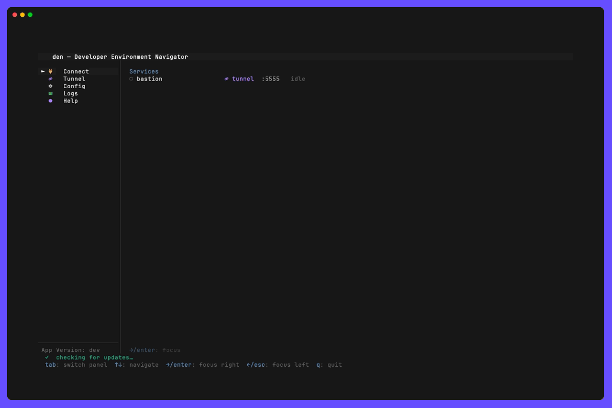

# Editing den.yaml



## What it is

You can change `den.yaml` while den runs. The new file takes effect without a
restart, and connections whose entry did not change stay up. If the file has a
mistake, den does not fall over and does not drop what is running.

- **In den:** press `e` in the Config panel to open `den.yaml` in your editor.
  When you close the editor, den checks the file and applies it.
- **Outside den** (in another window, a `git pull`): press `R` in any panel, or
  `r` in the Config panel. den does not watch the file.

Every check of the file lists **every** problem it finds, each with its line, in
two kinds:

- **Errors** keep den from using the file:
  - YAML that does not parse.
  - A value of the wrong kind, such as `local_port: abc`.
  - A missing or contradictory setting, such as a tunnel without `command` or a
    service naming an `env` that is not there.

  A file with an error is never applied. den keeps running the last version that
  had none, and opens a pop-up that lists the errors and offers to edit the file
  again or undo the edit.
- **Warnings** are things den runs with, but you probably did not mean. They are
  named, and the file is applied anyway:
  - A key den does not know, with the one you most likely meant:
    `unknown key "reconect", ignored`, and under it `→ did you mean "reconnect"?`.
  - A panel name `menu_order` or `disabled_panes` does not have.
  - A `logs.level` that is not a level.
  - A file that is not there, two services on one local port, an AWS profile that
    is not defined, a name used twice.

  Every problem has a hint on how to fix it. [Checking den.yaml](../config-check/README.md)
  has them all, and `den config --check` prints them without opening den.

If applying the file would stop a connection that is running (because you changed
or removed its entry), den asks first and names the connections. Answering `n`
keeps the old configuration until you press `R`.

Everything the file sets is applied on reload, including the left menu: add
`runbooks` to `menu_order`, save, and the panel is there.

```
╭────────────────────────────────────────────────────────────────────────────────╮
│  den.yaml has 1 error, 1 warning                                               │
│  den keeps running the last good version                                       │
│                                                                                │
│  ✗ line 6  tunnel[1] "jump": command is required                               │
│  ! line 7  unknown key "reconect", ignored                                     │
│                                                                                │
│  e: edit again  u: undo the edit  esc: close                                   │
╰────────────────────────────────────────────────────────────────────────────────╯
```

After `esc` the problems stay in sight:

- the status bar says `den.yaml has 1 error, den runs the last good version`;
- the Config menu entry carries a red dot and the number of problems (yellow for
  warnings only), and starting den with warnings only says so once in the status bar;
- the Config panel summarises the problems above the file, marks their lines, and
  `p` lists every one of them with its hint. If the pop-up cannot fit them all it
  says `… and 12 more — p in Config lists them`.

### Starting with a broken file

`den` opens anyway, with no services, on the Config panel with the errors in
front. Press `e`, fix the file, and close the editor: den applies it.

Every other command (`den list`, `den run`, `den mcp`, …) stops with each error on
a line of its own, in the `file:line: message` form editors and terminals jump to:

```
Error: invalid config:
  /home/me/.config/den/den.yaml:18: tunnel[0] "bastion": command is required
  /home/me/.config/den/den.yaml:27: vpn[0] "office": gateway or config_file is required
```

`den doctor` reports the same list under its `config` check, and
`den config --check` prints it with a hint under each problem and exits 1 on an
error, which a pipeline can use ([Checking den.yaml](../config-check/README.md)).

### How den checks the file, and the JSON Schema

The [JSON Schema](../schema/README.md) for `den.yaml` (`den schema`) is generated
from the same Go structs den decodes the file into. den does not run a JSON Schema
validator at runtime. It decodes the file strictly against those structs, which
gives the same structural checks (unknown keys, wrong types) with a line number
for each one. It also accepts exactly what den itself accepts: a schema validator
would reject `version: 1` or a quoted port, both of which den reads fine. The rules
a schema cannot express are den's own validation:

- a service's `env` exists;
- a tunnel's `auto_connect` names a VPN;
- `engine: mysql` needs `db_user`;
- names are unique.

den does use the schema at runtime, for the "did you mean" hints: it lists the
keys each section accepts. The panel names are in it too, so your editor underlines
a panel den does not have while you type.

## Configuration

None. The file is checked whenever den reads it. These keys are applied on reload
too, as well as the services, tunnels, VPNs, secrets and runbooks:

| Key | On reload |
|-----|-----------|
| `title` | The header shows the new title |
| `menu_order`, `disabled_panes` | The menu is rebuilt. The cursor stays on its panel, or goes back to the menu if that panel is gone |
| `logs.level`, `logs.file_location` | The new level applies at once. A new file is opened, and one no longer named is closed |
| `updates` | The next update check uses it |
| `aws.config_path`, `aws.credentials_path` | The AWS and Secrets panels read the new files |

## Prerequisites

- An editor. den opens `$VISUAL`, then `$EDITOR`, then `vi` (`notepad` on Windows).
  A GUI editor has to wait until its window closes: `code --wait`,
  `subl --wait`, `zed --wait`. Otherwise den checks the file the moment the
  command returns, before you change anything.

## Usage

1. Open the Config panel and press `e`.
2. Change the file, save, and close the editor.
3. One of these happens:
   - **No change:** den says `den.yaml unchanged`.
   - **No problems, nothing running affected:** applied at once. The status bar
     shows `config reloaded — 4 services, 1 connection kept`.
   - **Warnings only:** applied, and the status bar adds `1 warning, see Config`.
   - **A running connection would stop:** `y` applies it and stops that
     connection, `n` keeps the old config until `R`.
   - **Errors:** nothing changes. `e` edits the file again, `u` restores it as it
     was before you pressed `e` the first time, and `esc` leaves it as it is.

| Key | Where | What it does |
|-----|-------|--------------|
| `e` | Config panel | Open `den.yaml` in your editor; it is checked and applied when the editor closes |
| `r` | Config panel | Read the file again, check it and apply it |
| `p` | Config panel | List every problem with its hint; `enter` shows its line, `n` / `N` walk the marked lines |
| `R` | Any panel | The same, from anywhere |
| `e` | Error pop-up | Edit the file again |
| `u` | Error pop-up | Put the file back as it was before the edit |
| `y` / `n` | Confirm pop-up | Apply and stop the named connections / not now |
