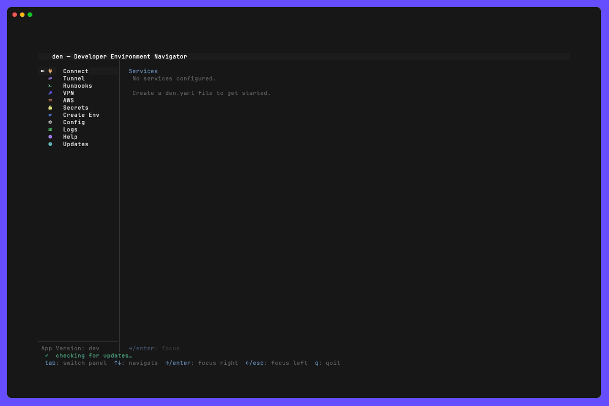

# Help panel



## What it is

The Help panel (`?` from the menu) is den's manual, inside den: a list of topics, one
per feature, grouped under headings. `↑`/`↓` move through them and `Enter` opens one.
Every topic is written the same way, so you know where to look whichever feature you
open:

- **What it is**: what the feature is for, and when you need it.
- **What you can do**: its capabilities, each saying where to find it.
- **Before you start**: the tools, IAM permissions and access it needs.
- **Configure**: every `den.yaml` key it takes, then several examples showing the
  options in use. Left out when the feature has nothing to configure.
- **Usage**: step by step, for a common task such as creating a runbook. Only where it
  helps.
- **Limitations**: what it does not do.
- **When it goes wrong**: the common errors, what causes them and the fix. Only where
  there is something to say.
- **See also**: related topics, and the feature's long reference in `docs/`.

Each section is drawn with its own Nerd Font icon and colour and a rule after it, and
each group of the list has an icon and a colour too, so you see where you are at a
glance. A topic's title and one-line summary sit above its box.

Keys are not in the topics: `h` or `?` in a panel lists what its keys do (see
[shortcuts](../shortcuts/README.md)).

`/` searches the text of every topic at once. The list narrows to the topics that
mention what you type, each with its number of matching lines, and `Enter` opens the
selected one at its first match.

The topics are the markdown files in [`docs/help/`](../help/README.md), embedded in the
binary, so the in-app help and the published one are the same text.

## Configuration

None. The Help panel can be hidden or moved like any other with `menu_order` and
`disabled_panes` (its name is `help`).

## Prerequisites

Nothing beyond den itself.

## Usage

Press `?` in the menu, or select **Help** and press `→`:

```
  Help   28 topics

   GETTING STARTED
   ▸ Getting started          Find, write, check and reload den.yaml
     Command line             Every den command, and what it is for

   CONNECTING
     Environments             Where services are reached from, written once
     Transports               SSM, SSH, EC2 Instance Connect or kubectl
     Tunnels                  Your own SSH forwards and SOCKS proxies
     VPN                      FortiGate VPN with a browser login, no sudo
     AWS SSO sessions         Log in to AWS without leaving den
   ↓ 21 more

  ↑↓: move  enter: open  /: search  h: keys
```

In the list:

| Key              | What it does                                              |
|------------------|-----------------------------------------------------------|
| `↑` `↓` (`k` `j`) | Move between topics; the headings are skipped            |
| `Home` `End`     | First and last topic                                      |
| `Enter` `→`      | Open the topic                                            |
| `/`              | Search every topic; `↑` `↓` still move while you type     |
| `Esc`            | Clear the search; with none on, back to the menu          |
| `h` `?`          | The panel's keys                                          |

In a topic:

| Key              | What it does                                              |
|------------------|-----------------------------------------------------------|
| `↑` `↓` `PgUp` `PgDn` | Scroll                                               |
| `/`              | Search this topic; the view jumps to the first match      |
| `n` `N`          | Next and previous match                                   |
| `Esc` `←`        | Clear the search; with none on, back to the list          |

`Esc` undoes one step at a time: after searching for `pgpass` from the list and
opening RDS, the first `Esc` clears the topic's search, the second goes back to the
list (still narrowed to `pgpass`), the third clears that, and the fourth returns to the
menu.

### Writing a topic

A topic is a file in `docs/help/`, listed under a group in `docs/help/README.md` as
`- [Title](file.md)`. It starts with `# Title` and a one-line summary of at most 50
characters, then the sections above, as `##` headings in that order. A section or a
group is drawn with the icon and colour `internal/tui/screens/help/style.go` gives it
(`templateSections`, `groupLooks`); a new one needs an entry there. The tests hold every
topic to it:

- `internal/tui/screens/help/topics_test.go`: the sections and their order, the
  summary's length, no tables, links or images (glamour renders them badly in a
  terminal), each paragraph, bullet and numbered step on one source line (glamour keeps a source line
  break inside a bullet), and every **See also** entry an existing topic or `docs/`
  path.
- `internal/config/helpdoc_test.go`: every ```` ```yaml ```` block decodes strictly
  into the config structs, and all of them merged form one config that validates. So
  names that must be unique (secrets, runbooks, sources) are unique across topics, and
  every `env:` a snippet names is defined in some topic. Every den.yaml section,
  service type, transport and secrets provider needs a snippet somewhere. A block that
  is not den.yaml (a shell command, a client's own config) is fenced without `yaml`.
- `internal/tui/components/markdownview_test.go`: every topic renders within the box
  at 40, 52 and 120 columns. A long unbreakable word, such as an ARN in inline code,
  is what usually fails it.
