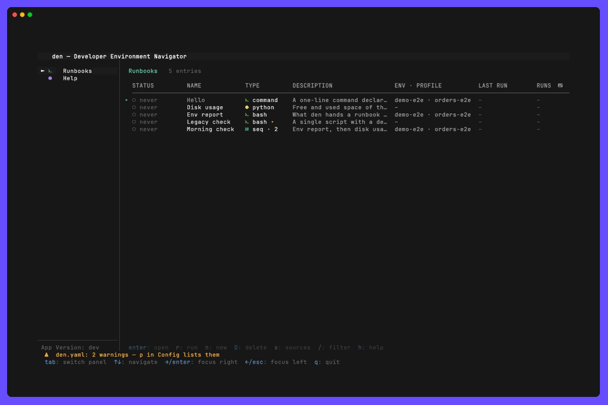
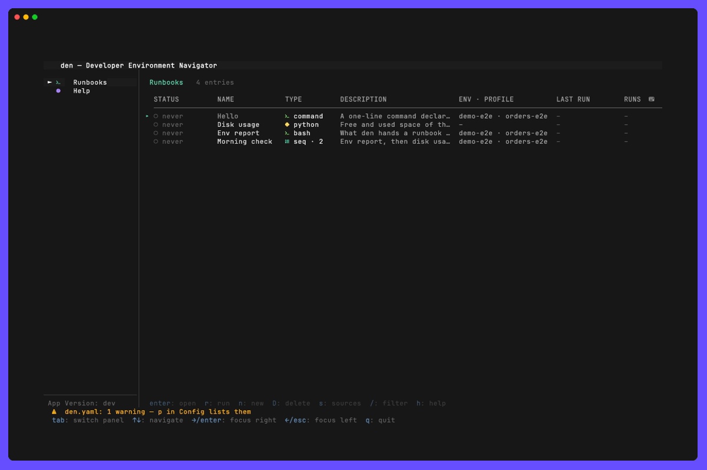

# Runbooks



## What it is

Runbooks let you run your own scripts and tools — shell, Python, Go, anything — from
inside `den`, with den's connection context already set up for them, and work on them
where they live.

The point is not that den can launch a script; your terminal does that. The point is that
**den already knows things your scripts need to know**: which AWS profile, which region,
which bastion instance, and which local port a live tunnel is bound to. A runbook receives
all of it as environment variables, so the script stops re-deriving connection details
every time.

Each runbook is **a folder of its own**: a `runbook.yaml` saying how to run it, and next to
it the scripts, helpers, virtualenv or data it needs. In den, a runbook opens like a
connected service does: its **logs** in one tab, its **past runs** and **what den hands it**
in two more, and **terminals that open in its folder** with the same environment, for
anything interactive — a script that prompts, a quick `aws` call, a fix in the editor.

Runbooks in a folder you commit are shared and discoverable by the whole team instead of
living in six people's `~/bin`. A git repository of runbook folders can also be added as a
**[runbook source](../runbook-sources/README.md)**: den checks it out, lists its runbooks as
`<source>/<name>` and asks before running one it has not seen.

### What it deliberately is not

Runbooks are not AWS Systems Manager Automation runbooks: those are documents that run
inside your AWS account; these are your own scripts, run on your machine with den's context.

Runbooks are not a workflow engine. There are no conditionals, no branching, no per-step
retry policies, no templating language, no parallel DAGs, no scheduling and no remote
execution.

Orchestration logic belongs **inside the script**, where you already have a real language
with real `if` statements. den gives you: an ordered list, environment injection, output
capture, an exit code, a history of runs, and a way to stop it.

## Configuration

### `den.yaml`

```yaml
runbooks:
  # Scanned for runbooks: every folder in them with a runbook.yaml is one.
  # Relative paths are read against this den.yaml's directory.
  dirs:
    - ~/.config/den/runbooks
    - ./ops/runbooks

  rescan: true                          # pick up folders added, changed or removed while den runs
  template: ~/.config/den/runbook-template   # what a new runbook folder is copied from
  agent: auto                           # who writes a runbook from a description: auto, a kind (claude, opencode, …) or an agents name
  agents:                               # command lines that write one; n offers them when there are two or more
    - name: Claude Opus                 # unique; not "auto"; no space at either end
      command: claude --model opus      # split on whitespace, no quotes; den adds its arguments after yours
    - name: Ollama GLM
      command: ollama launch claude --model glm-5:cloud   # den adds "--" before its own arguments
      # kind: claude                    # claude, codex, opencode, copilot, qwen, droid, pi or kimi; read from the command, needed only for other wrappers

  # Settings every runbook inherits; a runbook.yaml or an item overrides them.
  defaults:
    history: 20                         # finished runs kept on disk
    about: true                         # the About tab
    shell: ""                           # what t opens; empty is $SHELL
    editor: ""                          # what e and o open; empty is $VISUAL, $EDITOR, then vi
    agent: ""                           # what E changes a runbook with: a command line, or a name above; empty is runbooks.agent

  # Runbooks declared inline: handy for a one-line command.
  items:
    - name: "RDS status — prod"
      description: "Cluster status and engine version"
      env: prod                         # an entry of the environments: block
      command: |
        aws rds describe-db-clusters \
          --query 'DBClusters[].{Cluster:DBClusterIdentifier,Status:Status}' \
          --output table

  # Ordered lists of runbooks. Stops at the first failure.
  sequences:
    - name: "Prod maintenance window"
      description: "Check the bastion → snapshot → confirm healthy"
      confirm: true
      steps:
        - "Check bastion health"
        - "Snapshot before migration"
        - "RDS status — prod"
```

| Key                  | Required | Default  | Meaning                                                                                  |
|----------------------|----------|----------|------------------------------------------------------------------------------------------|
| `dirs`               | no       | none     | Directories holding runbook folders (and loose header scripts, below)                    |
| `rescan`             | no       | `true`   | Read `dirs` again every 5 s while the Runbooks panel or a runbook is on screen, and when an editor tab closes |
| `template`           | no       | built-in | A folder copied for every new runbook (`n` in the panel, `den runbook new`)               |
| `agent`              | no       | `auto`   | The agent CLI that [writes a runbook from a description](#write-one-with-an-agent): `auto` (the first installed, in the order of the kinds; with `agents`, the first entry), a kind such as `claude` or `opencode`, or an `agents` name |
| `agents`             | no       | none     | Command lines that write one, each with `name`, `command` and `kind`; see [Choosing the agent and model](#write-one-with-an-agent) |
| `defaults`           | no       | below    | The settings below, for every runbook                                                    |
| `items`              | no       | none     | Runbooks declared in den.yaml; same keys as a `runbook.yaml`                             |
| `sequences`          | no       | none     | Named runbooks run in order: `name`, `description`, `steps`, `confirm`                   |
| `sources`            | no       | none     | Git repositories of runbook folders — see [runbook sources](../runbook-sources/README.md) |
| `allow_sources`      | no       | any      | The repositories a source may come from, as `host/owner/repo` patterns                   |

### A runbook folder

```
~/.config/den/runbooks/
  rotate-db-password/
    runbook.yaml          # makes the folder a runbook
    run.sh
    README.md             # optional: shown in the About tab
  snapshot/
    runbook.yaml
    snapshot.py
    requirements.txt
  lib/                    # no runbook.yaml: a helpers folder, ignored
```

```yaml
# rotate-db-password/runbook.yaml
name: "Rotate app DB password"   # default: the folder's name
description: "Rotate the app user's password in Secrets Manager"
command: ./run.sh                # run through sh -c, inside this folder
env: prod
confirm: true                    # show the resolved command and ask first
timeout: 10m
params:
  - name: environment
    description: "Target environment"
    options: [test, int, prod]
    required: true
  - name: approver_token
    description: "Approval token"
    secret: true                 # masked input, redacted from output and history
history: 50                      # overrides runbooks.defaults
editor: nvim
agent: claude --model opus       # what E changes this runbook with
```

| Key           | Required | Meaning                                                                    |
|---------------|----------|----------------------------------------------------------------------------|
| `name`        | no (folder) / yes (item) | Display name, and the handle of `den run <name>`; a folder's defaults to the folder name |
| `command`     | yes      | Shell command, executed via `sh -c` (`cmd /C` on Windows)                  |
| `description` | no       | Shown under the selected row and in the view                               |
| `env`         | no       | Key into the `environments:` block; drives the injected AWS variables      |
| `cwd`         | no       | Working directory, relative to the folder (an item's: to den.yaml). Default: the folder (an item's: den.yaml's directory) |
| `env_vars`    | no       | Extra environment variables; these win over everything den sets           |
| `confirm`     | no       | Show the resolved command and require confirmation before running          |
| `timeout`     | no       | Go duration (`30s`, `5m`); the run is stopped when it elapses              |
| `params`      | no       | Values asked for before the run — see below                                |
| `retry`       | no       | Re-run until the script exits 0 — see below                                |
| `history`     | no       | Finished runs kept on disk, each with its own log; `0` keeps only the last run, in memory (default 20) |
| `about`       | no       | Show the About tab (default `true`)                                        |
| `shell`       | no       | What `t` opens in the folder, e.g. `bash --rcfile .venv/bin/activate` (default `$SHELL`) |
| `editor`      | no       | What `e` opens the script with, and `o` a run's log, e.g. `code --wait` (default `$VISUAL`, `$EDITOR`, `vi`) |
| `agent`       | no       | The agent `E` [changes the runbook with](#change-one-with-an-agent): a command line such as `claude --model opus`, or a kind such as `claude` or `opencode`, `auto` or the name of a `runbooks.agents` entry (default `runbooks.agent`) |

`history`, `about`, `shell`, `editor` and `agent` can be set in `runbooks.defaults` for every
runbook and overridden by one. `rescan` and `template` are set once, under `runbooks:`:
they are about the directories, not about one runbook.

A `runbook.yaml` is read **strictly**: a key den does not know (`confrim: true`) skips the
runbook with a warning instead of silently dropping what it was meant to set. It goes
through the same checks as a den.yaml item, so an unknown `env` skips it too.

### `params[]`

| Field         | Meaning                                                            |
|---------------|--------------------------------------------------------------------|
| `name`        | Reaches the script as `DEN_PARAM_<UPPERCASED_NAME>`                |
| `description` | Shown as the prompt's subtitle                                     |
| `default`     | Pre-filled value; used directly when running non-interactively     |
| `options`     | Non-empty renders a select instead of a text field                 |
| `required`    | Refuses to run without a value                                     |
| `secret`      | Masked while typing, redacted from output and from the history on disk |

### `retry`

Re-runs the command until it exits 0. This is the only control flow den offers, and it
exists because it covers most polling needs at almost no cost:

```yaml
retry:
  until_success: true
  interval: 15s          # required
  max_attempts: 40       # optional
  timeout: 20m           # optional ceiling across all attempts
```

`until_success` requires `max_attempts` or `timeout` — an unbounded retry would spin
forever with nothing in the config to reveal it. Before reaching for this, check whether
the AWS CLI already has a waiter: `aws rds wait db-cluster-snapshot-available`,
`aws ec2 wait instance-running` and friends are better than anything expressible in YAML.

### Loose header scripts

An executable file directly in a `dirs` directory is a runbook too when it carries a
`den:name` header, as before folders existed. It runs in its own directory. Both `#` and
`//` comments work:

```sh
#!/usr/bin/env bash
# den:name        Check bastion health
# den:description Verify the SSM bastion for this env is reachable
# den:env         prod
# den:timeout     30s
# den:param       tier options=test,prod default=test Which tier
set -euo pipefail
echo "instance ${DEN_EC2_INSTANCE_ID} · ${AWS_REGION} · profile ${AWS_PROFILE}"
```

The directives are `den:name` (required), `den:description`, `den:env`, `den:cwd`,
`den:confirm`, `den:timeout`, `den:param` (`<name> [options=a,b] [default=x] [required]
[secret] <description>`) and `den:retry_until_success`, `den:retry_interval`,
`den:retry_max_attempts`, `den:retry_timeout`. A file without `den:name` is skipped; one
with other directives but no name is reported, because that is almost always a typo. A
folder is the better home for anything with helpers or options with spaces in them.

Such a script has no folder of its own: it runs in the directory it sits in, and `t` opens
there, next to every other script. **`m`** in the panel (or `den runbook migrate <name>`,
`--all` for every one) moves it into a folder named after it, next to it, after asking:

```
runbooks/assume-role.sh   →   runbooks/assume-role/
                                runbook.yaml   what its den: lines said
                                run.sh         the script, without those lines
                                README.md      the comment block at its top
```

The script is removed once the folder is complete. The runbook keeps its name, its history
(its runs move into the folder's `logs/`) and its open terminals, and runs inside the folder
from then on; a `den:cwd` it had is kept. Outside a terminal, `den runbook migrate` needs `--yes`.

When names collide, den.yaml's items win over folders, and folders over loose scripts;
each skipped one is reported. Warnings are shown in the Runbooks panel (`w`) and by
`den run --list`.

### What a runbook gets

| Variable                    | Source                                        |
|-----------------------------|-----------------------------------------------|
| `AWS_PROFILE`               | `environments.<env>.aws_profile`              |
| `AWS_REGION`                | `environments.<env>.aws_region_code`          |
| `AWS_DEFAULT_REGION`        | same as `AWS_REGION`                          |
| `DEN_CREDENTIAL_PROFILE`           | `environments.<env>.credential_profile`          |
| `DEN_ENV`                   | `environments.<env>.environment`              |
| `DEN_REGION`                | `environments.<env>.region`                   |
| `DEN_EC2_INSTANCE_ID`       | `environments.<env>.ec2_instance_id`          |
| `DEN_ENV_NAME`              | the `env:` key itself                         |
| `DEN_CONFIG`                | absolute path to the active `den.yaml`        |
| `DEN_RUNBOOK`               | the runbook's name                            |
| `DEN_RUNBOOK_STATE`         | a folder of the runbook's own that outlives its runs (and, for a runbook from a source, its updates), made when it runs: `$XDG_DATA_HOME/den/runbook-state/<runbook>` |
| `DEN_PORT_<TYPE>_<NAME>`    | local port of a **live** connection (a tunnel reports its first `-D`/`-L` port, e.g. `DEN_PORT_TUNNEL_BASTION`) |
| `DEN_PARAM_<NAME>`          | an answered parameter                         |
| `FORCE_COLOR`, `CLICOLOR_FORCE` | `1`, for runs only, unless `NO_COLOR` is set (see [Colours](#colours)) |

Precedence, lowest to highest: inherited environment → colour request → den's context →
live ports → parameters → `env_vars`. A terminal opened with `t` gets the same, with each parameter's
default (secret ones left out): there is no run to answer them for. The About tab lists
exactly what den sets.

`DEN_PORT_*` describe connections that are **currently up**, so they exist only inside the
running TUI. A standalone `den run` has no tunnels of its own and exports none, rather than
point a script at a dead local port. Scripts that need a live tunnel should say so:

```sh
: "${DEN_PORT_RDS_ORDERS:?connect the orders rds service in den first}"
flyway -url="jdbc:postgresql://127.0.0.1:${DEN_PORT_RDS_ORDERS}/orders" info
```

### Colours

A run's output goes through pipes, not a terminal, and a tool that sees no terminal
prints plain text. So that Run and History can show what you see in a shell, den sets
`FORCE_COLOR=1` and `CLICOLOR_FORCE=1` for every run. Most tools and libraries honour one
of them (Node's chalk, Python's rich, BSD `ls`, …). A script that decides for itself with
`isatty()` should look at them too:

```python
use_colour = not os.environ.get("NO_COLOR") and (
    os.environ.get("FORCE_COLOR") or sys.stdout.isatty())
```

- **Turn it off** for one runbook with `NO_COLOR` in its `env_vars` (any value), or for
  everything by setting `NO_COLOR` in the environment den starts from. den then sets
  neither variable. `env_vars` always wins, so `FORCE_COLOR: "0"` there is kept.
- **A tool that ignores both** needs its own flag in the command: `grep --color=always`,
  `ls --color=always` (GNU), `git -c color.ui=always`, `aws … --color on`.
- **Shown in** the Run tab and, for a past run, in History, grey text with the script's
  colours on top; a colour that is reset goes back to grey, not to the terminal's default.
- **Also in the Logs panel**: every run started from the dashboard (a runbook, or a
  sequence and its steps) writes its lines there too, among den's own, each tagged with the
  runbook's or the sequence's name: `[15:04:07] [deploy] ✓ migrations applied`. `o` in the
  panel hides them and shows them again. The panel keeps the last 1000 of them apart from
  den's own 1000, so a long run does not push den's warnings out. They count as `info`:
  `logs.level: warn` leaves them out. `logs.file_location` gets them as `[RUN deploy] …`,
  without the colour codes. Runs of `den run` and `den mcp` are other processes and are
  not shown.
- **Kept in** the run's `log-NN.log`, as escape codes, so `cat` or `less -R` show them.
  `o` (open the log in the editor) opens a copy without the codes, in a temporary
  directory that goes when the editor exits cleanly.
- **Kept out of** `den mcp` (`run_runbook`, `service_logs`) and of `den run` when its output
  is not a terminal (a pipe, a file): there they are plain text.
- **Dropped everywhere**: every escape sequence but colour and style. A cursor move, a
  clear-line, a window title or a clipboard write (OSC 52) in a script's output would act
  on den's own screen, so spinners and progress bars that redraw with them show their
  last line as plain text.
- **Redaction** still works: a secret that a colour change splits in two is masked, and
  that line is shown without its colours.

### Where the history goes

A runbook in a folder keeps its runs in that folder, in `logs/`, numbered in the order
they ran:

```
~/.config/den/runbooks/assume-role/
├── runbook.yaml
├── run.sh
└── logs/
    ├── .gitignore    *: run output stays out of git, should the folder be in a repository
    ├── log-01.log
    ├── log-01.json
    ├── log-02.log
    └── log-02.json
```

- `log-NN.log` holds that run's output and nothing else, as den showed it, secrets masked.
  It is written line by line while the run goes, so `tail -f` follows it, a long run is
  kept whole (den holds only the last 5000 lines in memory) and a run den was killed
  during keeps what it printed;
- `log-NN.json` has the status, exit code, times, where it was started from (`tui`,
  `den run`, `mcp`) and the parameters that are not secret. It says `running` until the
  run is over; a run whose den died first is listed as `interrupted`.

Runbooks without a folder of their own — den.yaml's `items`, sequences, and runbooks from a
[source](../runbook-sources/README.md), whose folder an update replaces — keep the same files
in `$XDG_STATE_HOME/den/runbooks/<runbook>/` (by default `~/.local/state/den/runbooks/`,
`%LOCALAPPDATA%\den\runbooks\` on Windows).

den writes the `.gitignore` only when it makes `logs/` itself. A `logs/` your script already
uses is shared: den adds and prunes its own `log-NN` files and leaves everything else there
alone.

The files are readable by you only. Finished runs beyond the runbook's `history` are pruned
(the numbers go on: with `history: 20`, run 21 is `log-21` and `log-01` is gone);
a run still going, in this den or another, never is. Raising `history` keeps the runs that
are left and prunes nothing until there are that many: the ones pruned before are gone.
Lowering it prunes at the next run that finishes. The TUI, `den run` and `den mcp` all
record there, so a run an AI agent made shows up in the History tab too, and after a
restart every runbook shows its last run. A retried run keeps every attempt in its one log,
each after a `── attempt N ──` line.

## Prerequisites

- Whatever the scripts themselves need (`aws`, `python3`, `flyway`, …) on `$PATH`
- No extra IAM permissions beyond what the scripts use — den adds nothing of its own
- For `t` and `e`: a shell and an editor (`$SHELL`, `$VISUAL`/`$EDITOR`); on Windows the
  terminals use ConPTY (Windows 10 1809+), not yet tried
- Nerd Font for the panel's icons, as elsewhere in den
- For an agent to write runbooks: one of the [agent CLIs den starts](#write-one-with-an-agent),
  installed and logged in; `den doctor --for opencode` (or another kind) says how to install it

## Usage

### Create one

```
$ den runbook new "Rotate app DB password"
created /home/me/.config/den/runbooks/rotate-app-db-password

  edit   /home/me/.config/den/runbooks/rotate-app-db-password/run.sh
  run    den run 'Rotate app DB password'
  or open it in den: Runbooks, then enter
```

The folder holds a `runbook.yaml` naming every key it may set (commented out), a `run.sh`
that prints what den hands it, and a `README.md`. `--dir` creates it elsewhere. In the TUI,
`n` does the same and opens the new script in the editor. Under the name it says where the
folder goes, following what you type:

```
New runbook name
Goes into ~/.config/den/runbooks/rotate-app-db-password/ — change where with runbooks.dirs in den.yaml
> Rotate app DB password
```

The name is checked as you type it. A runbook or a sequence with that name, in any case,
or a folder the new one's would be (`Rotate keys!` goes into `rotate-keys/` too) is named
under it, and `enter` does not go on until it is free. `den runbook new` refuses the same
names.

### Delete one



Select it and press `D`, in the Runbooks panel or in its view, or from a shell:

```
$ den runbook delete "Rotate app DB password"
Rotate app DB password (folder)
Deletes:
  - ~/.config/den/runbooks/rotate-app-db-password/ — 9 files, 14.2 KB
  - 3 runs, with their logs
  - its state folder ~/.local/share/den/runbook-state/rotate-app-db-password-1f3a9c2e/, empty
Note:
  - sequence Prod maintenance window has it as a step: it stops loading until you change it
  - nothing can bring it back

Delete it for good? [y/N]
```

A deletion is for good: den keeps no copy, and in the TUI only `y` deletes (not `enter`).
Outside a terminal it needs `--yes`. What goes depends on where the runbook is defined:

| Runbook                          | Deleted                                         | Left alone, and said so                       |
|----------------------------------|-------------------------------------------------|-----------------------------------------------|
| A folder in `runbooks.dirs`      | The folder, `logs/` with it                     | A `cwd` or script outside the folder          |
| An entry of `runbooks.items`     | Its entry in `den.yaml`, comments kept          | Its `cwd` and whatever its command runs       |
| A sequence                       | Its entry in `den.yaml`                         | Its steps, which are runbooks of their own    |
| A `# den:` header script         | The script                                      | The runbooks directory, which others share    |
| A runbook from a [source](../runbook-sources/README.md) | Nothing: it is uninstalled (`exclude` in `den.yaml`) | Its checkout, shared with the source's other runbooks |

Every kind also loses what den keeps under its name: its runs in the state directory, its
`DEN_RUNBOOK_STATE` folder, and for a source runbook the record that you reviewed it. A
runbook given the same name later starts with none of it. The question also names:

- the sequences with a step of that name, which stop loading until you change them;
- a runbook of the same name den skipped until now, which takes its place;
- `runbooks.template`, when that is the folder;
- the git repository the folder is in, from which what was committed can come back.

It refuses a runbook that is running (here, or in `den run` or `den mcp` elsewhere), and
one a running sequence is going through. A folder is renamed out of the way before it is
deleted, so a rename that fails (a file in use on Windows) leaves it untouched. Terminals
open in its folder are stopped first.

### Write one with an agent

Describe what the runbook should do and let an agent CLI write it: Claude Code, Codex,
OpenCode, Copilot CLI, Qwen Code, Droid, Pi or Kimi Code. den gives the agent its runbook
guide — the folder and `runbook.yaml` format, what den sets in a run, the rules, notes for
bash, Python, Go, Rust and Node — and your environments with their AWS profile and region.
The agent checks its work before it hands over: with den's `validate_runbook` MCP tool
when it takes den's MCP server, else with `den runbook validate` from its shell. The
session is yours: it asks before it writes a file or runs a command, as it always does.

Each way has its own recording, with a config and notes of its own:
[`den runbook new --agent`](agents/cli/README.md),
[`n` in the panel](agents/panel/README.md) and
[den registered with your agent](agents/mcp/README.md). What you type in the panel is kept
as you type it: see [drafts and saved requests](agents/drafts/README.md).

**From the command line:**

```
$ den runbook new "RDS status" "check the status of my RDS instances in eu-staging, in Rust" --agent claude
created ~/.config/den/runbooks/rds-status

starting claude in it, with den's MCP tools and runbook guide…

  (claude writes Cargo.toml, src/main.rs, runbook.yaml and README.md,
   builds it, calls validate_runbook, and tells you how to run it)

RDS status is ready (rust)
  run    den run 'RDS status'
  or open it in den: Runbooks, then enter
```

`--agent` takes `auto`, a kind from the table below or the name of an entry in
`runbooks.agents` (an unknown name's error lists the configured ones); without it, the
description alone uses `runbooks.agent`. den starts the agent in the new folder and leaves
your agent's own configuration alone. den's MCP server is den's own binary, `den mcp -c
<your den.yaml>`; the guide comes with the task (write the runbook in this folder, check
it, say how to run it):

| Kind | Agent CLI | den's MCP server | The guide and the task | The request |
|---|---|---|---|---|
| `claude` | Claude Code | `--mcp-config`, and `--allowedTools` for den's two read-only tools | `--append-system-prompt` | the first argument |
| `codex` | Codex | `-c mcp_servers.den.command` and `.args` | `-c developer_instructions` | the last argument |
| `opencode` | OpenCode | a config den writes and names in `OPENCODE_CONFIG`, which OpenCode merges with yours | a file that config's `instructions` lists | `--prompt` |
| `copilot` | Copilot CLI | `--additional-mcp-config`, and `--allow-tool` for den's two read-only tools | an `AGENTS.md` in a folder den puts first in `COPILOT_CUSTOM_INSTRUCTIONS_DIRS` | `-i` |
| `qwen` | Qwen Code | none: `den runbook validate` | `--append-system-prompt` | `-i` |
| `droid` | Droid | none: `den runbook validate` | `--append-system-prompt-file` | the last argument |
| `pi` | Pi | none: `den runbook validate` | `--append-system-prompt`, with a file's path | the last argument |
| `kimi` | Kimi Code | none: `den runbook validate` | `--agent-file`: an agent that keeps Kimi's own prompt and reads the guide from a file | in the instructions: type `go` |

The files den writes for OpenCode, Copilot CLI, Droid, Pi and Kimi Code go in `agents/`
under den's state directory (`den paths` shows it), in a folder of their own for each start:
starting the same agent on the same runbook with the same request reuses it, and den
removes the folders it has not used for 30 days. They hold the guide, the task and paths,
never a credential, and only you can read them.

**Agents without den's MCP server.** Qwen Code, Droid, Pi and Kimi Code cannot be given an
MCP server for one session without changing your own configuration, so den does not try.
Their instructions say: wherever the guide says `validate_runbook`, run `den runbook
validate -c <your den.yaml> <the folder>` in your shell, and the other den tools are not
there. That command loads the folder as den will and reports what `validate_runbook`
would, the same fields with `--json`; it exits 1 while the folder does not load. den says
which way an agent checks its work when it starts it:

```
starting pi in it, with den's runbook guide; it checks its work with den runbook validate…
```

Kimi Code takes no first prompt in its TUI: den puts the request in its instructions and
says `Kimi Code takes no first prompt: type go in it to start`. Type `go` (or anything
short) there and it begins.

den exits with the agent's exit code, after saying whether the folder loads.

**Limits:**

- OpenCode: den's config takes the place of an `OPENCODE_CONFIG` of your own for that
  session. Your global and project configs still load, and so does what `ollama launch
  opencode` passes.
- Kimi Code waits for you to type `go`, as above.
- Qwen Code, Droid, Pi and Kimi Code run `den runbook validate` with their shell tool, so
  they ask before running it when that tool asks before a command.

**Choosing the agent and model:** `runbooks.agents` lists command lines, each with a
`name` and a `command`:

```yaml
runbooks:
  agent: Claude Opus
  agents:
    - name: Claude Opus
      command: claude --model opus
    - name: Codex GPT
      command: codex --model gpt-5.4
    - name: Ollama GLM
      command: ollama launch claude --model glm-5:cloud
    - name: OpenCode Sonnet
      command: opencode --model anthropic/claude-sonnet-4-5
    - name: Copilot
      command: ollama launch copilot-cli      # kind copilot
    - name: Pi
      command: pi
```

- `name`: required and unique, without a space at either end. `auto` is reserved; a
  kind's name (`claude`, `opencode`, …) is allowed and replaces the built-in agent of that
  name.
- `command`: required. It is split on whitespace, with no shell quoting (the same on
  Windows). The first word is the program: a kind's program (`claude`, `opencode`, …) is
  found the way `den doctor` finds it, anything else on `PATH`. Your words come first,
  den's arguments (the request, `--mcp-config`, and so on) after them.
- `kind`: one of the kinds in the table above — `claude`, `codex`, `opencode`, `copilot`,
  `qwen`, `droid`, `pi` or `kimi` — which decides the arguments den adds. Left out, it is
  read from the program (`opencode`, also with a path or `.exe`) or from
  `ollama launch <kind>`, where `ollama launch copilot-cli` is `copilot` too. A wrapper den
  cannot read it from needs `kind`, or the file does not load.
- `ollama launch <integration> [--model M]` runs the tool through Ollama; everything
  after a standalone `--` goes to that tool, so den puts `--` before its own arguments.
  Ollama's integrations of the other kinds of tool (`chatgpt`, `hermes`, `cline`, …) are
  not agents den can start.
- `runbooks.agent` names the default: `auto`, a kind or an entry. Without it the first
  entry is the default. When it names a kind and no entry has that name, the built-in
  agent is offered too, and is the default. `auto` without entries starts the first kind
  installed, in the table's order: claude, codex, opencode, copilot, qwen, droid, pi, kimi.
- Entries whose program is not installed are left out of the pop-up.

**From the Runbooks panel:** `n` asks for the name and, when an agent is installed,
*Ask an agent to write it (optional)*. The answer box grows with what you type, up to what the
pane has room for, then scrolls (`rows 4–12 of 20` under it); `ctrl+j` or `alt+enter` starts a new line.
`↑` on its first row, or `shift+tab`, goes back to the name to change it, and the answer
stays. With two or more agents, an `Agent  ‹ name ›  (1/3)` row sits under the answer:
`tab` (or `↓` from the answer's last row) moves to it, `←` and `→` choose and wrap, `↑` or
`shift+tab` go back to the answer, `enter` creates. With one agent there is no row. With an answer, the agent runs in a terminal tab of the
new runbook's view, in its folder, so you watch it work inside den. In that tab one `esc`
is the agent's (Claude Code interrupts with it); `esc` twice or `ctrl+t` gives den the keys
back. When the
agent quits, den reads the folder again. Leave the answer empty to get `run.sh` in your
editor instead. `esc` with something typed asks *Keep as a draft?*: a kept draft is a row
of the list and `n` offers it again, and an agent restarted on its tab can be sent its
request again ([drafts and saved requests](agents/drafts/README.md)).

### Change one with an agent

`E`, in the Runbooks panel and in a runbook's view, asks *What should change in NAME?*
and starts an agent on the runbook that exists. The key line names the agent, the model
included: `E: edit with claude opus`.

Which agent is the runbook's own `agent:` key, so one runbook can ask for a stronger model
than the rest. It is read like `runbooks.agents[].command` (split on whitespace, no quotes;
the kind is read from the program), or it is a name:

```yaml
# runbook.yaml
agent: claude --model opus
```

```yaml
# den.yaml: for every runbook that does not say; a name from runbooks.agents works too
runbooks:
  defaults:
    agent: Claude Opus
```

Without the key the choice is `runbooks.agent`, as for `n`. A command line of a wrapper den
cannot read the kind from (`./my-agent.sh`) goes into `runbooks.agents` with `kind`, and the
runbook names the entry.

The answer box works as `n`'s does (it grows, scrolls, `ctrl+j` starts a new line); `enter`
starts the agent in a terminal tab of the view, in the runbook's folder, `esc` drops the
question, and an empty answer starts the agent without a request, to tell it yourself. The
agent gets den's runbook guide and `validate_runbook` (or `den runbook validate`, for an
agent without den's MCP server), as when it writes a runbook, and is told the runbook
exists: change what the request needs, keep the rest. A tab whose agent
quit restarts the same agent, still changing the runbook, with `enter`. When the agent quits,
den reads the folder again.

`E` refuses what an agent should not rewrite, and says why: a sequence (open one of its
steps), a runbook declared in `den.yaml` (move it into a folder by hand), a one-script runbook
(`m` moves it into a folder first), and an `agent` den cannot start (its program is missing,
or it is no `runbooks.agents` name and starts none of the kinds). A runbook from a source offers
the copy `e` offers: edit the copy. A runbook from a source ignores its own `agent`, like its
`shell` and `editor`: the agent that changes it is yours to choose.

**From your agent, with den registered once:**

```bash
claude mcp add den -- den mcp -c ~/.config/den/den.yaml      # Claude Code
codex mcp add den -- den mcp -c ~/.config/den/den.yaml       # Codex
```

Then ask in plain words, or in Claude Code use den's prompt:
`/mcp__den__new_runbook check the status of my RDS instances in eu-staging, in Rust`.
(`den mcp` is a server the agent starts itself: it is not piped into it.)

### The Runbooks panel

A table of every runbook and sequence:

```
 Runbooks   5 entries

   STATUS       NAME                       TYPE       DESCRIPTION                ENV · PROFILE             LAST RUN       RUNS      ⌨
   ────────────────────────────────────────────────────────────────────────────────────────────────────────────────────────────────
 ▸ ✓ exit 0     ! Rotate app DB password    bash     Rotate the app user's pa…  prod · orders-prod        2h ago · 2.1s  137 · 2✗  ⌨ 1
   ○ never        Snapshot                  python   Snapshot before a migra…   prod · orders-prod        –              –
   ◐ 0:42         Flyway migrate            go       Run pending migrations     int · orders-int          –              1
   ○ never        Check bastion health      bash •   Verify the SSM bastion …   prod · orders-prod        –              –
   ✗ exit 1       Prod maintenance window   seq · 3  Check the bastion → sna…   prod · orders-prod        1d ago · 1:12  12 · 1✗
 ⚠ 1 warning — w to show
  enter: open  r: run  x: cancel  n: new  /: filter  h: help
```

| Column        | What it shows                                                                  |
|---------------|--------------------------------------------------------------------------------|
| STATUS        | How the last run ended (`✓ exit 0`, `✗ exit 1`, `⊘ cancelled`), how long the one in flight has run, or `○ never` |
| NAME          | The name; `!` in front when it asks before running                             |
| TYPE          | What it runs, with its icon in the language's colour (Python yellow, Go cyan, AWS orange, …; Nerd Font glyphs, coloured by den): the interpreter of its script (the shebang, else the extension: `bash`, `python`, `go`, `node`, `ruby`, `perl`, `pwsh`, …), else the program its command starts (`aws`, `terraform`, `kubectl`, `docker`, `make`, …), else `command` for a one-line command and `shell` for a multi-line one; `seq · N` for a sequence. An amber `•` marks a [single script](#loose-header-scripts) that `m` moves into a folder |
| DESCRIPTION   | Its description                                                                |
| ENV · PROFILE | The `env:` it runs with and the AWS profile that resolves to; `mixed` for a sequence whose steps differ |
| LAST RUN      | When the last run finished, and how long it took                              |
| RUNS          | How many times it has run, from den, `den run` or `den mcp`, the one in flight included, then, in red, how many of the runs it keeps (`history`) failed or timed out: `137 · 2✗`. Pruning old runs does not lower the count; with `history: 0` it counts only this session's runs |
| ⌨             | Its terminals that are running                                                 |

On a narrow terminal the table gives up RUNS first, then LAST RUN, then DESCRIPTION, then TYPE, so
that the name and the account stay readable.

| Key               | Action                                                  |
|-------------------|---------------------------------------------------------|
| `↑` `↓` / `k` `j` | Move between entries (`pgup`, `pgdn`, `g`, `G`)         |
| `enter`           | Open the runbook's view; on a [draft](agents/drafts/README.md), its form again |
| `r`               | Run it: parameters, then confirmation, then the run     |
| `x`               | Cancel its run (SIGINT, then kill after a grace period) |
| `n`               | New runbook folder; an agent can write it, else it opens in the editor. With drafts, offers them first |
| `E`               | [Change it with its agent](#change-one-with-an-agent): asks what, then starts the agent in a tab of its view |
| `m`               | Move a single-script runbook into its own folder        |
| `D`               | [Delete it for good](#delete-one), after a question listing what goes; a draft after a question of its own |
| `s`               | [Runbook sources](../runbook-sources/README.md): add, update, install and uninstall |
| `/`               | Filter the list                                         |
| `w`               | Show the discovery warnings                             |
| `h` / `?`         | [Shortcuts pop-up](../shortcuts/README.md)              |

### The runbook view

```
╭──────────────────────────────────────────────────────────────────────────────╮
│  runbook  Rotate app DB password  ✓ EXIT 0 · 2.1s · Fri 12:04   env prod     │
│ ──────────────────────────────────────────────────────────────────────────── │
│ ~/.config/den/runbooks/rotate-app-db-password   ./run.sh                     │
│ ! asks before running · bash · timeout 10m · keeps 50 runs · y: copy den run │
│ ──────────────────────────────────────────────────────────────────────────── │
│─ Run │ History │ About │ Files │ 1 zsh ● │ 2 nvim ○                          │
│[12:04:29] rotating app_rw in prod                                            │
│[12:04:31] ✓ new password stored                                              │
╰──────────────────────────────────────────────────────────────────────────────╯
  h: help  r: run  t: shell here  e: edit  E: edit with claude opus  o: log in editor  ←→: tabs  esc: back
```

- **Run** — the current or last run's output, full height, following the tail.
- **History** — the runs kept on disk, newest first, with the selected run's own log
  under them and the file it is in; a run in flight is there from its first line. The
  runs take up to two thirds of the tab; when there are more, `↓ 9 more · 26 of 30 runs
  kept` says how many and `↑` `↓` scroll to them. `enter` shows that log full height,
  `esc` goes back to the runs.
- On either, `o` opens that run's log file in your editor, in a terminal tab named after
  it (`log-07`): search it, copy from it, save part of it. The editor is the one `e` uses.

```
│─ Run │ History │ About │ Files                                                │
│▸ ✓ exit 0      2.1s     Fri 3 Oct 12:04  tui       tier=prod                 │
│  ✗ exit 1      0.8s     Fri 3 Oct 11:52  den run   tier=prod                 │
│  ✗ interrupted –        Thu 2 Oct 17:10  mcp       tier=stage                │
│── Fri 3 Oct 12:04 · exit 0 · from tui · …/rotate-app-password/logs/log-07.log │
│[12:04:29] rotating app_rw in prod                                            │
│[12:04:31] ✓ new password stored                                              │
```
- **About** — the folder's `README.md`, where the runbook is defined and runs, the
  variables den sets for it (with the live ports), its parameters and settings.
- **Files** — the runbook's folder as `tree -l` lists it: hidden files left out, linked
  folders followed. `↑` `↓` pick a file and `enter` shows it in the tab, rendered as About
  is: a markdown file formatted, anything else coloured as code after its name (`run.sh`,
  `runbook.yaml`, a `Makefile`; a script without an extension by its `#!` line). `esc`
  goes back to the tree. `e`, on the file shown or on the tree, opens it in your editor,
  in a terminal tab named after it. When the editor closes, its tab closes too and you are
  back on Files, the file you edited still shown and following the edit; den reads the
  folder again (`runbooks.rescan`, on by default), so the next `r` runs what you saved. An
  editor that fails (not installed, say) keeps its tab, so its error can be read, and
  `enter` there opens the file again. A binary file is only described, and only the first 256 KB of a
  big one are shown. den's own runs
  fold into one `logs/` row (`enter` on it goes to History); anything else a script keeps
  in `logs/` is listed under it. A tree or a file taller than the tab scrolls, its last
  row saying how far down you are (`scroll  37%`; `pgup` `pgdn`, `g` `G` jump). Only a runbook with
  a folder of its own has Files. Editing a file of a runbook from a source makes it ask
  before its next run: see [Runbook sources](../runbook-sources/README.md).

```
│─ Run │ History │ About │ Files │ 1 run.sh ●                                   │
│  .                                                                           │
│  ├── logs/  7 runs · History                                                 │
│  ├── README.md                                                               │
│▸ ├── run.sh                                                                  │
│  ├── runbook.yaml                                                            │
│  └── sql/                                                                    │
│      └── rotate.sql                                                          │
│                                                                              │
│ 2 directories, 4 files                                                       │
```
- **Terminals** — `t` opens your shell **in the runbook's folder**, with its environment:
  run the script by hand when it prompts, poke at the data, call `aws` as the runbook
  would. `e` opens the script in your editor, and `o` a run's log; when the editor closes,
  its tab closes and den goes back to the tab you pressed the key on, reading the folder
  again. They work exactly like a service's [terminal tabs](../terminal/README.md): `esc`
  or `ctrl+t` gives den the keys back (at the shell's prompt one `esc`, oh-my-zsh or not;
  inside `vim`, `less` or an agent the first `esc` is theirs and a second right after it is
  den's), `1`–`9` jump to one, `n` renames and `x` closes it.
  They keep running when you leave the view; quitting den stops them.

| Key          | Action                                                               |
|--------------|----------------------------------------------------------------------|
| `r`          | Run it (parameters and confirmation first, as a pop-up)              |
| `x`          | On Run, History, About or Files: cancel the run. On a terminal: close it |
| `t`          | New terminal: your shell in the runbook's folder                     |
| `e`          | Open its script in the editor, in a terminal tab; on Files, the file picked or shown |
| `E`          | [Change it with its agent](#change-one-with-an-agent): asks what to change, then starts the agent in a terminal tab |
| `o`          | On Run or History: open the run's log file in the editor, in a terminal tab |
| `m`          | Move a single-script runbook into its own folder (asks first)        |
| `D`          | [Delete it for good](#delete-one), after a question listing what goes |
| `y`          | Copy the `den run` command for it                                    |
| `←` `→`      | Previous / next tab (or `tab`, `shift+tab`)                          |
| `1`–`9`      | Jump to a terminal and type into it                                  |
| `enter`      | Type into a terminal; restart an exited one; on History, a run's whole log; on Files, show the file picked |
| `↑` `↓`      | Scroll Run and About; pick a run in History, or scroll its whole log; pick a file in Files, or scroll the one shown |
| `esc`        | Back to the list (from a terminal: back to den's keys first; from a run's whole log: back to the runs; from a file shown: back to the tree) |

A sequence's view has Run, History and an About that lists its steps; it has no folder of
its own, so no Files and no terminals. A runbook declared in `den.yaml` or by a single script
has no Files either: it runs in a directory it shares.

### Command line

```bash
den run --list [--json]                         # runbooks and sequences, with warnings
den run "Check bastion health"                  # exits with the script's exit code
den run "Rotate app DB password" \
        --param environment=prod --yes
den run "Prod maintenance window" --yes         # sequences share the namespace
den runbook new "Snapshot" [--dir ./ops/runbooks]
den runbook new "RDS status" "check my RDS instances, in Rust" --agent claude
den runbook validate ./ops/runbooks/rds-status [--json]   # what validate_runbook reports; exits 1 while it does not load
den runbook migrate "Check bastion health"      # a header script into its own folder
den runbook migrate --all --yes                 # every one, without asking
den runbook delete "Snapshot" [--yes]           # for good, with its runs and state (alias rm)
```

`den run` exits with the script's own exit code, which is what makes the same committed
definitions usable from CI and cron. Cancellation exits `130`; a timeout exits `124`.
Missing parameters are asked for at a terminal, and are an error in a pipeline.

### Safety

den runs shell commands named in files that arrive over `git pull`, so:

- **Nothing runs on startup.** A runbook executes only on an explicit keypress or CLI
  invocation; a rescan only reads the folders.
- **`confirm: true`** shows the fully resolved command, its origin, working directory and
  parameters before anything happens. A sequence asks if any of its steps would.
- **In a non-TTY, a `confirm` runbook refuses to run without `--yes`.** The gate fails
  closed. Through `den mcp`, it asks the user.
- **A misspelt key in a `runbook.yaml` skips the runbook** instead of dropping the key.
- **Deleting asks first, and only `y` answers it.** `den runbook delete` fails closed
  outside a terminal without `--yes`; nothing outside a runbooks directory, and no folder
  holding `den.yaml` or a runbooks directory, is ever deleted.
- **Secret parameters** are masked while typing, and redacted from the output den shows
  and from the history it writes.
- **Cancellation interrupts first.** The whole process group gets SIGINT and a grace
  period to run its traps, and is force-killed only if it ignores that — a script
  part-way through a prod snapshot gets the chance to clean up.
