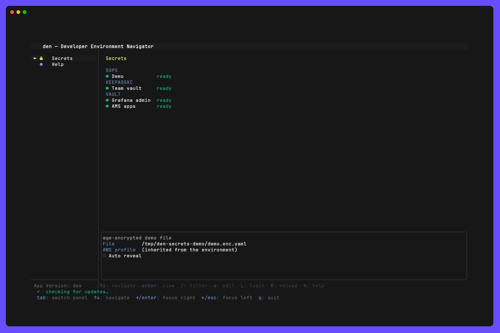

# Secrets



## What it is

The Secrets pane opens secrets without leaving den. Four providers are supported:

- **[SOPS](https://github.com/getsops/sops):** den decrypts the file through the
  `sops` CLI. You can browse its keys, laid out like the YAML file itself, reveal
  or copy one value, or edit the file in `$EDITOR`. SOPS re-encrypts the file when
  you save.
- **[AWS Secrets Manager](#aws-secrets-manager):** den reads the secret with the AWS
  SDK as your profile. It is read-only.
- **[KeePassXC](#keepassxc):** den reads an entry of a `.kdbx` database through
  `keepassxc-cli`, asking you for the master password. It is read-only.
- **[HashiCorp Vault](#hashicorp-vault):** den reads KV v1/v2 secrets through the
  `vault` CLI with your own token, and `L` runs your login command (OIDC and so
  on). It is read-only.

For SOPS, it replaces this shell step:

```bash
AWS_PROFILE=acme-dev sops edit ~/repos/infra/secrets/eu-staging.enc.yaml
```

What den does and doesn't do with your secrets:

- **`den.yaml` holds references only.** It contains file paths, secret IDs and AWS
  profiles, never values, so the file stays safe to commit.
- **Decrypted values stay in memory.** They are never written to disk, the Logs
  pane, the log file or a command line.
- **Values are masked by default.** Only the selected row can be revealed, and moving
  the cursor hides it again. `a` reveals every value, and `auto_reveal: true` makes a
  secret open that way. Use it only where nobody can see your screen: the values are
  shown on screen, and in any screen share or recording.
- **Values are dropped when you leave.** `Esc`, `←`, `Tab` or switching panes drops
  the decrypted values. Opening the secret again reads it again.
- **Copies are cleared after 30 s.** `y` copies a value and clears the clipboard 30 s
  later, unless you've copied something else since. If den quits before then, the
  clipboard isn't cleared. Where there is no system clipboard (over SSH, a Linux
  machine without `xclip`/`wl-copy`) the copy goes to the terminal (OSC 52), which den
  cannot read back: that clear empties the clipboard without checking what is on it.
- **den stores no keys, and passwords only when you ask it to.** sops finds the
  key (AWS KMS, age, PGP) from the file's own metadata, and den only exports the
  AWS profile a KMS key needs. Secrets Manager uses your existing AWS login for
  that profile. Vault uses the token your `vault login` left (`~/.vault-token`,
  `VAULT_TOKEN` or a token helper). A KeePass master password is the one exception, because there's
  no login session to reuse. den asks for it and sends it to `keepassxc-cli` on
  stdin, and keeps it only if the entry sets `remember_password`
  ([details](#the-master-password)).

## Configuration (`den.yaml`)

Secrets are grouped by provider: `sops`, `aws_secretsmanager`, `keepassxc` and
`vault`. Any other group, for example `aws_ssm:`, is rejected at load time with a clear error instead of
being ignored. Names must be unique across all groups.

### Tree or flat view

A secret with nested values (a SOPS file, a JSON secret in Secrets Manager or
Vault) opens as a tree, indented like the YAML it came from, or as a flat list
with one dotted key per value:

```
tree (default)                          flat
  cicd-database-secret:                   cicd-database-secret.password    ••••••••
    password: ••••••••                    client.aacn.apiKey               ••••••••
  client.aacn:                            client.aacn.basicauth.clientId   ••••••••
    apiKey:             ••••••••          hosts[0]                         ••••••••
    basicauth.clientId: ••••••••
  hosts:
    - ••••••••
```

The tree keeps keys that contain dots (`client.aacn`, `basicauth.clientId`) apart
from real nesting, which the flat list can't show. Parent keys are headings: the
cursor moves over values only, so `r`, `y` and `/` work the same in both views.

```yaml
secrets:
  view: tree                             # every secret: tree (default) or flat
  sops:
    - name: "Legacy env file"
      file: ./secrets/dev.enc.env
      view: flat                         # this one opens flat
```

| Key                  | Required | Description                                                       |
|----------------------|----------|-------------------------------------------------------------------|
| `secrets.view`       | no       | `tree` (default) or `flat`, for every secret that doesn't set its own. |
| `view` (on a secret) | no       | `tree` or `flat` for this secret: SOPS, Secrets Manager and Vault. KeePassXC entries have no nesting and always open flat. |

`t` switches the open secret between the two views. Closing and opening it again
starts from the config.

### SOPS

```yaml
secrets:
  sops:
    - name: "EU STAGING"
      description: "App secrets for EU STAGING"
      file: ~/repos/infra/secrets/eu-staging.enc.yaml
      aws_profile: "acme-dev"
      aws_region: "eu-central-1"
      auto_reveal: true                  # values start in clear

    - name: "Local dev"
      file: ./secrets/dev.enc.env        # age or PGP: no AWS settings needed
```

| Key           | Required | Description                                                                  |
|---------------|----------|------------------------------------------------------------------------------|
| `name`        | yes      | Shown in the pane. Unique across all groups.                                 |
| `description` | no       | Shown in the box under the list.                                             |
| `file`        | yes      | The encrypted file. `~` is expanded. YAML, JSON, dotenv and INI all work.    |
| `aws_profile` | no       | Exported as `AWS_PROFILE` for KMS keys. Without it, sops uses your current environment. |
| `aws_region`  | no       | Exported as `AWS_REGION`.                                                    |
| `auto_reveal` | no       | `true` shows every value in clear when the secret opens. Default `false` (masked). `a` toggles it at runtime. |
| `view`        | no       | `tree` or `flat` ([above](#tree-or-flat-view)). Default: `secrets.view`, else `tree`. `t` toggles it at runtime. |

Keys are shown in the file's own order, nested as in the file, or as dotted paths
(`db.password`, `hosts[0]`) in the flat view.

### AWS Secrets Manager

```yaml
secrets:
  aws_secretsmanager:
    - name: "Orders API key - staging"
      description: "API client private key"
      secret_id: "/acme/orders/staging/api-key"
      aws_profile: "acme-dev"
      aws_region: "eu-central-1"
      version_stage: "AWSCURRENT"
      auto_reveal: false
```

| Key             | Required | Description                                                              |
|-----------------|----------|--------------------------------------------------------------------------|
| `name`          | yes      | Shown in the pane. Unique across all groups.                             |
| `description`   | no       | Shown in the box under the list.                                         |
| `secret_id`     | yes      | The secret's name, or its full ARN. Use the ARN for a secret in another account. |
| `aws_profile`   | no       | Profile the SDK reads as. Without it, the default credential chain.      |
| `aws_region`    | no       | Region of the secret. Without it, the profile's region.                  |
| `version_stage` | no       | `AWSCURRENT` (default), `AWSPREVIOUS` or a custom staging label.         |
| `auto_reveal`   | no       | As for SOPS.                                                             |
| `view`          | no       | As for SOPS.                                                             |

A JSON object or array secret is shown like a SOPS file, as a tree or dotted
keys, for example `client_id` and `private_key`. Any other string shows as a single `value` row, and
a binary secret as `value (base64)`. A multi-line value (a PEM key) is shown on
one row with `⏎` marking the line breaks. `y` copies the original, line breaks
included.

The identity behind `aws_profile` needs `secretsmanager:GetSecretValue` on the
secret, plus `kms:Decrypt` if it's encrypted with a customer-managed KMS key. If
it's missing, opening the secret shows AWS's own reason, for example
`AccessDeniedException: … because no identity-based policy allows the
secretsmanager:GetSecretValue action`, and the item turns red.

The provider is read-only: `e` shows "editing is not supported".

### KeePassXC

```yaml
secrets:
  keepassxc:
    - name: "Jenkins service account"
      description: "CI login"
      database: ~/secrets/team.kdbx
      entry: "CI/Jenkins"
      key_file: ~/.keys/team.key
      attributes: [UserName, Password, URL, Notes]
      totp: true
      remember_password: 10m
      auto_reveal: false

    - name: "AMS"                        # pick from every entry under a group
      database: ~/secrets/team.kdbx
      group: "AppointmentManagement360"
      remember_password: 10m

    - name: "Team vault"                 # pick from every entry in the database
      database: ~/secrets/team.kdbx
```

| Key                 | Required | Description                                                          |
|---------------------|----------|----------------------------------------------------------------------|
| `name`              | yes      | Shown in the pane. Unique across all groups.                         |
| `description`       | no       | Shown in the box under the list.                                     |
| `database`          | yes      | The `.kdbx` file. `~` is expanded.                                   |
| `entry`             | no       | One entry, by its path in the database: `Group/Sub/Title`, leaving out the root group. Without it, den lists entries to pick from. |
| `group`             | no       | With no `entry`: list only the entries under this group, including subgroups. Can't be combined with `entry`. |
| `key_file`          | no       | Key file used together with (or instead of) the master password.     |
| `no_password`       | no       | `true` for a database opened by `key_file` alone. den never prompts. Needs `key_file`. |
| `attributes`        | no       | Attributes to show, in order. Default `UserName`, `Password`, `URL`, `Notes`. Custom attributes work too. |
| `totp`              | no       | `true` adds a `TOTP` row with the current code.                      |
| `remember_password` | no       | How long den keeps the master password, e.g. `10m`. Unset means asked on every open. |
| `cli_path`          | no       | Path to `keepassxc-cli`. By default den looks on `PATH`, then in `/Applications/KeePassXC.app` on macOS. |
| `auto_reveal`       | no       | As for SOPS.                                                         |

#### Picking an entry

With `entry` set, opening the item shows that entry. Without it, opening the
item (and typing the master password) lists entry paths:

- the whole database, or everything under `group`
- groups, empty groups and the Recycle Bin are left out

`/` searches the list by path, and `Enter` opens an entry's fields. From an
entry, `Esc` goes back to the list and drops that entry's values. `Esc` on the
list closes the database.

To find an entry's path for `entry`, open the database in the KeePassXC app, or
list every path (it asks for the master password):

```bash
keepassxc-cli ls -R -f ~/secrets/team.kdbx
# on macOS, if keepassxc-cli isn't on PATH:
/Applications/KeePassXC.app/Contents/MacOS/keepassxc-cli ls -R -f ~/secrets/team.kdbx
```

Lines ending in `/` are groups. The other lines are entries.

A multi-line value such as Notes shows on one row with `⏎` marking the line
breaks, and `y` copies it with the line breaks. The provider is read-only: `e`
shows "editing is not supported".

#### The master password

`keepassxc-cli` has no login session to reuse, so every read needs the master
password:

- **Asking.** Opening the entry shows a masked password field in the pane.
  `Enter` unlocks and `Esc` cancels. Every key is typed into the field, `q` and
  `h` included. A wrong password shows "wrong password — try again" and asks
  again. It doesn't turn the entry red.
- **Handing it over.** The password goes to `keepassxc-cli` on stdin only, never
  as a command-line argument (which other users can see with `ps`) or an
  environment variable.
- **Without `remember_password`.** For a single `entry`, den drops the password
  as soon as the read finishes, and asks again on the next open. While you're
  picking from a list, den keeps the password until you close the database
  (`Esc` on the list, or leaving the pane), so each entry doesn't ask again.
  Then it's dropped.
- **With `remember_password: 10m`.** den keeps the password in its own memory for
  10 minutes. Every entry in the same database (with the same key file) opens
  without asking during that time. When the time is up it's forgotten.
- **Forgetting it early.** `l` forgets every remembered password at once, and
  quitting den forgets them too.

"Drops" and "forgets" mean den clears its own copy of the bytes. Like any Go
program, den can't guarantee that no other copy lingers in memory until the
garbage collector reuses it. If that matters to you, leave `remember_password`
unset.

Each `keepassxc-cli` call re-derives the database key, which is slow on purpose
(about a second with the default settings). A read is one call, or one per
attribute when a value spans several lines, so an entry with a multi-line Notes
takes a few seconds to open.

### HashiCorp Vault

```yaml
secrets:
  vault:
    - name: "Grafana admin"
      description: "Shared Grafana login"
      address: "https://vault.example.com"
      namespace: "team-a"
      mount: "secret"
      path: "grafana/admin"
      field: "password"
      login: "vault login -method=oidc"

    - name: "AMS apps"                   # pick from every secret under a folder
      address: "https://vault.example.com"
      path: "apps/ams/"
      login: "vault login -method=oidc"
```

| Key           | Required | Description                                                          |
|---------------|----------|----------------------------------------------------------------------|
| `name`        | yes      | Shown in the pane. Unique across all groups.                         |
| `description` | no       | Shown in the box under the list.                                     |
| `address`     | no       | Exported as `VAULT_ADDR`. Without it, your environment's is used.    |
| `namespace`   | no       | Exported as `VAULT_NAMESPACE` (Vault Enterprise / HCP).              |
| `ca_cert`     | no       | Exported as `VAULT_CACERT`, for a server with a private CA. `~` is expanded. |
| `mount`       | no       | The KV secrets engine's mount. Default `secret`.                     |
| `path`        | yes      | The secret's path under the mount. A path ending in `/` is a folder, and den lists every secret under it, subfolders included, to pick from. |
| `field`       | no       | Show only this key (and anything nested under it). One secret only.  |
| `version`     | no       | A KV v2 version number. The latest when unset. One secret only.      |
| `login`       | no       | Shell command `L` runs to log in, e.g. `vault login -method=oidc`.   |
| `cli_path`    | no       | Path to `vault`. By default den uses the one on `PATH`.              |
| `auto_reveal` | no       | As for SOPS.                                                         |
| `view`        | no       | As for SOPS.                                                         |

den runs `vault kv get -format=json -mount=<mount> <path>` and shows the
secret's data as keys. It works for KV v1 and v2, and v2 metadata is left out.
Nested JSON values are shown like a SOPS file. A value stored as a JSON
string stays one string.

A folder is listed with `vault kv list`, one call per subfolder. The list shows
full paths (`apps/ams/kafka/e2e`), sorted, with the same search, `Enter` and
`Esc` as KeePassXC. den stops after 500 secrets or 10 levels deep and says so
next to the count. Point `path` at a smaller folder if you hit that.

The provider is read-only: `e` shows "editing is not supported".

#### Logging in

den never handles Vault credentials. The `vault` CLI finds your token in
`VAULT_TOKEN`, `~/.vault-token` (written by `vault login`) or a configured
`token_helper`:

- **No token at all.** The status shows `vault login required`, with
  `— L to log in` when `login` is set.
- **`L`.** Hands the terminal to the `login` command, run through `sh -c` with
  the entry's `VAULT_ADDR`, `VAULT_NAMESPACE` and `VAULT_CACERT`. For
  `-method=oidc` your browser opens. When the command finishes, den re-checks
  every secret's status. If the open secret had failed, den reads it again.
- **A token that has expired, or has no access to the path.** den can't see this
  without calling the server, so it shows up when you open the secret:
  `vault: permission denied — token expired or no access (L to log in)`. The item
  turns red until a read succeeds.

## Prerequisites

- **SOPS: sops 3.9 or newer** on `PATH`: den edits through `sops edit`, which
  sops 3.9 added (older versions still decrypt). `den check-install --for sops`
  checks it and prints the install command for your OS; see also the
  [releases page](https://github.com/getsops/sops/releases). den also checks
  that one of the keys the file is encrypted to is available (below) and says
  which one is missing.
- **SOPS: access to the file's key:**
  - **AWS KMS:** a valid session for `aws_profile`. If SSO has expired, log in from
    the AWS pane. The IAM identity needs `kms:Decrypt` on the key, plus
    `kms:Encrypt` / `kms:GenerateDataKey` to save edits.
  - **age:** `SOPS_AGE_KEY_FILE`, or the default `~/.config/sops/age/keys.txt`.
  - **PGP:** the key in your keyring. A GUI pinentry such as `pinentry-mac` is
    needed if the key has a passphrase, because den can't show a terminal
    pinentry while the TUI is running.
- **SOPS: `$EDITOR`** set for `e`. If it's unset, sops falls back to `vim` / `nano`.
- **AWS Secrets Manager:** a valid session for `aws_profile` (log in from the AWS
  pane) and the IAM permissions above. No extra tools are needed.
- **KeePassXC:** `keepassxc-cli`, which ships with KeePassXC 2.x:
  - **macOS:** installing the app (`brew install --cask keepassxc`) is enough. den
    finds the CLI inside `KeePassXC.app`, even though it isn't on `PATH`.
  - **Linux:** the `keepassxc` package puts `keepassxc-cli` on `PATH`.
  - **Windows:** `keepassxc-cli.exe` is next to `KeePassXC.exe`. Set `cli_path` if
    it isn't on `PATH`.
  - A database protected by a YubiKey challenge-response isn't supported yet.
- **Vault:** the `vault` CLI (`brew install hashicorp/tap/vault`, or a release
  from [developer.hashicorp.com](https://developer.hashicorp.com/vault/install)).
  Version 1.11 or newer, for `-mount`. Your token also needs a policy allowing
  `read` on the secrets, plus `list` for folders.

### Status

The status next to each secret is worked out without decrypting, or calling AWS or
the Vault server.
It checks, in order:

| Status                                   | Meaning                                                                 |
|------------------------------------------|-------------------------------------------------------------------------|
| `sops not installed`                     | No `sops` on `PATH` (SOPS only)                                         |
| `file not found`                         | `file` doesn't exist (SOPS only)                                        |
| `keepassxc-cli not installed` / `cli_path not found` | No CLI found (KeePassXC only)                               |
| `database not found` / `key file not found` | (KeePassXC only)                                                     |
| `vault not installed` / `cli_path not found` | No `vault` CLI found (Vault only)                                   |
| `vault login required` (`— L to log in`) | No `VAULT_TOKEN`, `~/.vault-token` or `token_helper` (Vault only)       |
| `unknown AWS profile <name>`             | `aws_profile` isn't in the AWS config den reads (`aws.config_path`, default `~/.aws/config`) |
| `SSO login expired — log in from the AWS pane` | `aws_profile` is an SSO profile and its cached login is missing or expired |
| `decrypt failed — enter for details`     | The checks passed but the last read failed, e.g. missing IAM or KMS permissions. It stays red until a read succeeds, or until the AWS login it was read with changes. |
| `ready`                                  | Every check passed                                                      |

Profiles using static keys, `credential_process` or `role_arn` aren't checked
beyond existing, so problems with them show up as `decrypt failed`. The full
error is shown when you open the secret.

#### When the status is refreshed

Every secret is checked when den starts and when the config is reloaded (`R`).
A secret is checked again when you open or edit it, and all of them after an
edit or a Vault login.

Secrets read through an AWS profile (SOPS files with a KMS key, Secrets Manager)
also follow the AWS login by themselves:

- **Log in from the AWS pane or the Connect list** and the secrets waiting for that
  login turn `ready`. There's no need to reload or restart.
- **Log in outside den** (`aws sso login` in another terminal) and they turn
  `ready` within about five seconds, while the Secrets list is on screen.
- **When a login runs out**, they go back to `SSO login expired`, the same way.

This stays cheap with many secrets. den reads `~/.aws/config` and the SSO cache
once for all of them, and only looks at the secrets again when a login, a logout
or an expiry actually happened. Secrets that don't use AWS (age or PGP keys,
KeePassXC, Vault) are left alone, and a SOPS file isn't read again unless it
changed.

## Usage

Select **Secrets** in the left menu and press `→` or `Enter` to focus the list.

| Key     | Action                                                        |
|---------|---------------------------------------------------------------|
| `↑`/`↓` | Move between secrets, or between keys when a secret is open   |
| `Enter` | Open the selected secret and list its keys (values masked)    |
| `/`     | Filter: secrets by name, description or location; in an open secret, keys only |
| `r`     | Reveal / hide the selected value                              |
| `a`     | Reveal / hide every value                                     |
| `t`     | Switch the open secret between tree and flat view             |
| `y`     | Copy the selected value; the clipboard is cleared after 30 s  |
| `e`     | Edit in `$EDITOR` via `sops edit` (SOPS only)                 |
| `l`     | Forget every remembered KeePassXC master password             |
| `L`     | Run the selected secret's `login` command (Vault)             |
| `Esc`   | Clear the filter; then close the secret and drop its values   |
| `R`     | Reload the config                                             |
| `h` / `?` | [Shortcuts pop-up](../shortcuts/README.md)                  |

The details box under the list shows the selected secret's settings. Its dots
match the toggles in the VPN and Tunnel panes, green when on: **Auto reveal**
for every secret, and **Remember password** for KeePassXC entries.

### Search

`/` opens a search bar at the bottom, the same as in the Connect pane:

- In the list, it matches names, descriptions and locations (file path or
  secret ID).
- In an open secret, it matches **key names only, never values**. Matching values
  would show which masked rows contain what you typed, which gives them away.
- While you type, `↑`/`↓` move through the results. Every other key is text,
  including `j`, `k`, `h` and `q`.
- `Enter` closes the bar and keeps the filter, so `r`, `a`, `y` and `e` act on the
  remaining rows. In the list, `Enter` also opens the secret you picked.
- `Esc` while typing clears the query. When a filter is kept, the first `Esc`
  clears it and the next one closes the secret.

### Editing (SOPS)

`e` works both from the list and from an open file. den hands the terminal to
`sops edit` and comes back when the editor closes. If you saved, the open file
is decrypted again so you see the new values. Closing without changes shows
"no changes".

## Providers: supported and planned

| Provider | `den.yaml` group | Status | Edit |
|----------|------------------|--------|------|
| SOPS (KMS, age, PGP) | `sops` | Supported | `e` via `sops edit` |
| AWS Secrets Manager | `aws_secretsmanager` | Supported | read-only |
| KeePassXC (`.kdbx`) | `keepassxc` | Supported | read-only |
| HashiCorp Vault (KV v1/v2) | `vault` | Supported | read-only |
| AWS SSM Parameter Store | `aws_ssm` | Planned | — |
| Any CLI (`pass`, `gopass`, `op`, `bw`, …) | `command` | Planned | optional `edit` command |

A planned group in `den.yaml` stops den loading with
`secrets.<group>: unsupported provider`. The commented examples in `den.yaml`
show the config each one is intended to take.

### Planned providers

- **SSM Parameter Store (`aws_ssm:`)** would read through the AWS SDK like Secrets
  Manager: one `parameter`, or every parameter under a `path` (optionally
  `recursive`). SecureString values would be decrypted, which needs `kms:Decrypt`.
  The status checks would be the same as for Secrets Manager.
- **Any command (`command:`)** would run a `get` command that prints the secret,
  either as JSON (flattened like SOPS) or as `key: value` lines, with `requires:`
  naming the binary the status should check for. An optional `edit` command would
  enable `e`. This covers `pass` / `gopass`, the 1Password CLI (`op`) and the
  Bitwarden CLI (`bw`, which needs `BW_SESSION`) without code changes in den.

### Candidates, not designed yet

- Azure Key Vault (`az keyvault secret show`)
- Google Secret Manager (`gcloud secrets versions access`)
- Kubernetes Secrets (`kubectl get secret`, values base64-decoded)
- Native 1Password or Bitwarden providers, if the `command` group turns out to be
  too limited for them

### Other planned improvements

- **KeePassXC:** YubiKey challenge-response databases.
- **Vault:** editing (`vault kv patch`), and other secrets engines than KV
  (for example dynamic database credentials).
- **Using secrets elsewhere:** let runbook parameters and services read a value
  from a configured secret.

### Adding a provider

A provider is a package under `internal/secrets/<name>/`:
- **Required:** an `Item` implementing `secrets.Item`: name, location, details,
  a status check that never decrypts, and `Read`.
- **Optional:** `Editor` (the `e` key), `Unlocker` (a password den must ask for),
  `Locker`, `Browser` (pick entries from a list), `Toggler` (extra dots in the
  details box), `Viewer` (values that nest, opened as a tree unless `view:
  flat`) and `AWSUser` (read through an AWS profile, so the status is checked
  again after an SSO login). The pane finds these at runtime, so it needs no
  change for a new provider.
- **Config:** a spec in `internal/config/schema.go`, with validation in
  `validateSecrets`, and a loop in `Items` in
  `internal/secrets/providers/providers.go`, which also fills an empty `view`
  from `secrets.view`.
- **Shared helpers in `internal/secrets`:** `AWSLogins.Check` for the AWS profile
  and SSO checks, and `FlattenJSON` for JSON secrets, which keeps each value's
  path for the tree view. `Items` hands every AWS-backed item the same
  `AWSLogins`, so the AWS config is read once however many secrets use it. Such
  a provider takes it in its constructor and implements `AWSUser`.
